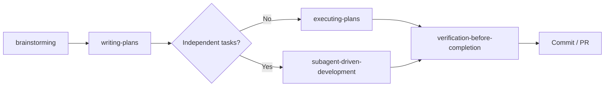

# DSH Skill Catalog

A reference for the **75 skills** available in this DeepSeek Harness workspace — what each one does, when it triggers, and how to choose between the ones that overlap.

> Generated 2026-11-20 · DSH Desktop · catalog is session-scoped and may change as plugins are installed or removed.

---

## Contents

- [How skills work](#how-skills-work)
- [At a glance](#at-a-glance)
- [The core workflow chain](#the-core-workflow-chain)
- [Process & meta](#process--meta-8)
- [Architecture & API design](#architecture--api-design-7)
- [AI & ML](#ai--ml-4)
- [Infrastructure & reliability](#infrastructure--reliability-6)
- [Languages, frameworks & backend](#languages-frameworks--backend-15)
- [Data & databases](#data--databases-5)
- [Quality, security & testing](#quality-security--testing-7)
- [Design & content](#design--content-7)
- [Office & documents — engine](#office--documents--engine-7)
- [Office & documents — business writing](#office--documents--business-writing-8)
- [Browser](#browser-1)
- [Choosing between overlapping skills](#choosing-between-overlapping-skills)
- [Running with approvals disabled](#running-with-approvals-disabled)

---

## How skills work

A **skill** is a reusable, task-specific instruction set. The catalog in a session is only a set of one-line summaries — the full instructions live in each skill's `SKILL.md` and are loaded on demand.

- **Loading is explicit.** The agent calls a `skill` tool with the exact skill name before doing the work. Instructions are never inferred from a summary.
- **Triggering is two-way.** You can name a skill directly ("use `the-fool` on this plan"), or the agent matches a skill whose trigger conditions fit the request.
- **Loaded skills are authoritative.** Once loaded, the skill's instructions take precedence for that task.

Local plugins differ from the rest: **`browser-skill`** ships as a plugin bundle in the profile (with a `skill/SKILL.md`), while the other 74 are injected by the harness at session start.

---

## At a glance

| Category | Count | Purpose |
| --- | ---: | --- |
| Process & meta | 8 | Plan, execute, verify, critique |
| Architecture & API design | 7 | Systems, services, schemas, requirements |
| AI & ML | 4 | Prompts, fine-tuning, pipelines, retrieval |
| Infrastructure & reliability | 6 | CI/CD, IaC, Kubernetes, SLOs, chaos |
| Languages, frameworks & backend | 15 | Implementation per stack |
| Data & databases | 5 | Analysis, pipelines, query tuning |
| Quality, security & testing | 7 | Review, hardening, debugging, tests |
| Design & content | 7 | Identity, tokens, UI, banners, decks |
| Office — engine | 7 | Word / Excel / PowerPoint / PDF |
| Office — business writing | 8 | Documents, charts, data quality |
| Browser | 1 | Logged-in Chromium automation |
| **Total** | **75** | |

---

## The core workflow chain

The process skills are designed to be used in sequence, not independently:

`the-fool` can be inserted before or after planning to stress-test assumptions, and `spec-miner` substitutes for the front of the chain when the "requirements" are an existing undocumented codebase.

---

## Process & meta (8)

| Skill | What it does · when to use |
| --- | --- |
| `using-superpowers` | Entry point to the skill system — how to discover and invoke skills. Use at the start of a conversation. |
| `brainstorming` | Mandatory gate before **any** creative work: features, components, behavior changes, plans, even non-software projects. Explores the real problem before building. |
| `writing-plans` | Turns a spec or set of requirements into a multi-step implementation plan. Use before touching code. |
| `executing-plans` | Executes that plan inline, with the agent itself as implementer. Use when subagents are unavailable or unwanted. |
| `subagent-driven-development` | Executes plans by delegating independent tasks to subagents. Use when the plan has genuinely parallelizable work. |
| `verification-before-completion` | Requires running verification commands and confirming output before claiming anything is done, fixed, or passing. Use before commits and PRs. |
| `the-fool` | Structured adversarial critique of an idea, plan, or decision — devil's advocate, pre-mortem, red team, assumption and evidence audit. |
| `spec-miner` | Reverse-engineers specifications and architecture docs from existing, legacy, or undocumented code. |

## Architecture & API design (7)

| Skill | What it does · when to use |
| --- | --- |
| `architecture-designer` | High-level system architecture: diagrams, ADRs, technology trade-offs, scalability, infrastructure patterns. |
| `microservices-architect` | Distributed design: service boundaries, DDD, monolith decomposition, sagas, event sourcing, CQRS, service mesh, tracing. |
| `cloud-architect` | AWS / Azure / GCP architecture, migration plans, Well-Architected reviews, cost optimization, disaster recovery, landing zones. |
| `legacy-modernizer` | Incremental migration: service boundaries, dependency maps, migration roadmaps, strangler fig, branch by abstraction. |
| `feature-forge` | Requirements workshops producing user stories, EARS-format functional requirements, acceptance criteria, implementation checklists. |
| `api-designer` | REST / GraphQL resource modeling, OpenAPI specs, versioning strategy, pagination, error standards. |
| `graphql-architect` | GraphQL schema design, Apollo Federation, DataLoader-based resolver optimization, subscriptions. |

## AI & ML (4)

| Skill | What it does · when to use |
| --- | --- |
| `prompt-engineer` | Prompt templates, structured output schemas, chain-of-thought and few-shot design, evaluation rubrics and prompt test suites. |
| `fine-tuning-expert` | LoRA / QLoRA adapters, JSONL dataset prep, hyperparameters, PEFT and Hugging Face training, OpenAI fine-tuning, DPO / RLHF, quantization and deployment. |
| `ml-pipeline` | Experiment tracking (MLflow / W&B), Kubeflow or Airflow DAGs, Feast feature stores, model registries, retraining and validation automation. |
| `rag-architect` | Chunking, embeddings, vector stores, hybrid search, reranking, retrieval-quality evaluation. |

## Infrastructure & reliability (6)

| Skill | What it does · when to use |
| --- | --- |
| `devops-engineer` | Dockerfiles, CI/CD pipelines, Kubernetes manifests, Terraform / Pulumi templates, GitOps, release automation, incident runbooks. |
| `terraform-engineer` | Reusable modules and module versioning, state migration and backends, imports, provider config, multi-environment workflows, infrastructure testing. |
| `kubernetes-specialist` | Deployments, RBAC, NetworkPolicies, Helm charts, storage, pod-crash debugging, log inspection, resource right-sizing, multi-cluster management. |
| `monitoring-expert` | Prometheus / Grafana dashboards, alerting rules, structured logging, distributed tracing, profiling, k6 / Artillery load tests, capacity planning. |
| `sre-engineer` | SLIs / SLOs, error budgets, incident response procedures, capacity models, toil reduction. |
| `chaos-engineer` | Chaos experiments, failure-injection frameworks, blast-radius control, game days, rollback procedures, post-mortem templates. |

## Languages, frameworks & backend (15)

| Skill | What it does · when to use |
| --- | --- |
| `python-pro` | Typed Python 3.11+, async/await, dataclasses, dependency injection, logging, pytest suites, strict mypy, ruff/black. |
| `fastapi-expert` | FastAPI + Pydantic V2 endpoints, async SQLAlchemy, auth and JWT flows, WebSockets, OpenAPI generation. |
| `django-expert` | Django models and migrations, DRF serializers and viewsets, `select_related` / `prefetch_related` optimization, JWT auth. |
| `django-storages-s3` | Django 4.2+ `STORAGES` dict, S3-backed static and media, public/private backends, presigned URLs, CloudFront, IAM policies, S3 mocking in tests. |
| `javascript-pro` | Modern ES2023+ patterns, ESM, Promise-based async flows, Web Workers, Fetch API, Node and browser performance. |
| `typescript-pro` | Advanced generics, conditional and mapped types, discriminated unions, branded types, monorepo setup, tRPC end-to-end typing. |
| `react-expert` | React 18/19 components and hooks, Suspense boundaries, server components, `useActionState`, state management, render debugging. |
| `nextjs-developer` | App Router, React Server Components, server actions, route handlers, middleware, streaming SSR, `generateMetadata`, Vercel deployment. |
| `vue-expert` | Vue 3 Composition API and composables, Nuxt 3 SSR/SSG, Pinia stores, Quasar / Capacitor, PWA features, Vite build tuning. |
| `nestjs-expert` | NestJS modules, controllers, services, DTOs, DI, guards / interceptors / pipes, TypeORM or Prisma, Swagger, unit and E2E tests. |
| `dotnet-core-expert` | .NET 8 minimal APIs, clean architecture, EF Core, CQRS with MediatR, JWT authentication, AOT compilation. |
| `spring-boot-engineer` | Spring Boot 3, Spring Security 6 flows, Spring Data JPA, reactive WebFlux, Spring Cloud microservices. |
| `cli-developer` | Argument parsing, subcommands, interactive prompts, progress bars and spinners, bash/zsh/fish completions (commander, click, typer, cobra). |
| `websocket-engineer` | WebSocket and Socket.IO systems, bidirectional messaging, horizontal scaling with Redis, presence tracking, room management. |
| `mcp-developer` | MCP servers and clients: tool handlers, resource providers, stdio / HTTP / SSE transports, Zod or Pydantic schemas, protocol debugging. |

## Data & databases (5)

| Skill | What it does · when to use |
| --- | --- |
| `pandas-pro` | DataFrame joins, pivots, groupby aggregations, resampling, NaN interpolation and forward-fill, dtype conversion, large-dataset performance. |
| `spark-engineer` | Spark DataFrames and SQL, RDD pipelines, shuffle tuning, partitioning, Parquet processing, structured streaming, cluster and executor config. |
| `sql-pro` | Complex joins, window functions, CTEs, recursive queries, index strategy, EXPLAIN / ANALYZE interpretation, before/after benchmarking, dialect migrations. |
| `postgres-pro` | EXPLAIN analysis, JSONB operations, extensions, VACUUM tuning, replication configuration, performance monitoring. |
| `database-optimizer` | Slow-query investigation, execution plans, index design, configuration tuning, partitioning, lock contention — PostgreSQL and MySQL. |

## Quality, security & testing (7)

| Skill | What it does · when to use |
| --- | --- |
| `code-reviewer` | PR and diff review: bugs, SQL injection, XSS, insecure deserialization, N+1 queries, code smells, naming, architectural concerns — structured, prioritized report. |
| `security-reviewer` | Security audits and SAST-style review, severity-rated vulnerability reports, dependency and secrets scanning, compliance checklists. |
| `secure-code-guardian` | Implements security: authentication and authorization, bcrypt / argon2 hashing, parameterized SQL, CORS / CSP headers, Zod validation, JWT sessions, OWASP Top 10 hardening. |
| `debugging-wizard` | Error and stack-trace parsing, hypothesis-driven isolation, log correlation, systematic root-cause analysis. |
| `test-master` | Unit, integration, and E2E tests; mocking strategy; coverage-gap analysis; test architecture; test plans and defect reports; k6 performance testing; OWASP security testing; flaky-test debugging. |
| `playwright-expert` | Playwright E2E: page objects, fixtures, reporters, CI integration, API mocking, visual regression, flake debugging. |
| `fullstack-guardian` | End-to-end security across database → API → UI: auth, input validation, output encoding, parameterized queries at every layer. |

## Design & content (7)

| Skill | What it does · when to use |
| --- | --- |
| `design` | Umbrella skill: brand identity, design tokens, logo generation (55 styles), corporate identity programs and CIP mockups, HTML presentations, banners (22 styles), icons (15 styles), social photos. |
| `brand` | Brand voice, visual identity, messaging frameworks, asset management, brand consistency and compliance. |
| `design-system` | Three-layer token architecture (primitive → semantic → component), CSS variables, spacing and typography scales, component specifications, brand-compliant slide generation. |
| `ui-styling` | shadcn/ui + Radix + Tailwind: accessible dialogs, dropdowns, forms and tables; themes and dark mode; responsive layouts; canvas-based visual design. |
| `ui-ux-pro-max` | Searchable local design dataset — 79 styles (50 active), 192 product palettes, 74 font pairings, 119 UX guidelines, 105 icons, GSAP presets, 25 chart types, 22 stacks. |
| `banner-design` | Banners for social, ads, website heroes and print: minimalist, gradient, bold type, photo, illustrated, geometric, retro, glassmorphism, 3D, neon, duotone, editorial, collage. |
| `slides` | Strategic HTML presentations with Chart.js, design tokens, responsive layouts, copywriting formulas, contextual slide strategies. |

## Office & documents — engine (7)

Start with **`office`** whenever the deliverable is a real document; it routes to the others.

| Skill | What it does · when to use |
| --- | --- |
| `office` | Router: choose the right workflow for Word, Excel, PowerPoint, or PDF deliverables. |
| `office-docx` | Create, read, edit, and validate Word documents (`.docx`). |
| `office-xlsx` | Read, create, edit, and validate Excel workbooks, data, and formulas (`.xlsx`). |
| `office-pptx` | Create, read, edit, and validate PowerPoint presentations (`.pptx`). |
| `office-export-pdf` | Convert an Office document to PDF via LibreOffice Kit. |
| `office-recalculate` | Refresh spreadsheet formula caches and verify calculated values. |
| `office-render` | Render document images or inspect visual layout. |

## Office & documents — business writing (8)

Chinese-language business workflows, all producing editable Office output.

| Skill | What it does · when to use |
| --- | --- |
| `gov-doc-writing` | 公文写作 — notices, reports, and requests by issuing organization, document type, role, and current material. |
| `meeting-recap` | 会议纪要 — agenda, discussion, decisions, action items, owners, and deadlines. |
| `research-writer` | 研究报告 — research questions, evidence, sources, judgments, risks. |
| `saas-metrics-coach` | 经营指标 — revenue, MRR, customer retention, growth assumptions, and calculation hygiene. |
| `work-report-writer` | 工作汇报 — daily, weekly, monthly, and phase summaries; checks deliverables, numbers, risks, next steps. |
| `data-viz-gen` | 数据图表 — chart selection and annotation by data type and business question; preserves native formulas and charts. |
| `dataset-health-audit` | 数据质量 — missing values, outliers, units, definitions, duplicates, and reproducible calculations. |
| `code-documenter` | Docstrings, JSDoc, OpenAPI / Swagger specs, doc portals, getting-started guides, tutorials. |

## Browser (1)

| Skill | What it does · when to use |
| --- | --- |
| `browser-skill` | Drive a logged-in Chromium through the `bsk_*` tools: read pages, fill forms, manage tabs, debug sites, test UIs. Installed as a local plugin; requires the `bsk` CLI and the BrowserSkill Chrome extension. |

---

## Choosing between overlapping skills

The overlap is deliberate — broad umbrellas and narrow specialists. Pick by **scope of the decision**:

| If the question is… | Use | Not |
| --- | --- | --- |
| "What should we build?" | `brainstorming`, `feature-forge` | `writing-plans` |
| "How do we build it, step by step?" | `writing-plans` | `brainstorming` |
| "Should we build it at all?" | `the-fool` | `brainstorming` |
| "What does this existing code do?" | `spec-miner` | `writing-plans` |
| "How should the system be shaped?" | `architecture-designer` | `microservices-architect` |
| "Should this be one service or many?" | `microservices-architect` | `architecture-designer` |
| "Where should it run?" | `cloud-architect` | `devops-engineer` |
| "How do we get off this legacy system?" | `legacy-modernizer` | `spec-miner` |
| "What's the brand / identity?" | `brand` or `design` | `design-system` |
| "What exact tokens and specs?" | `design-system` | `design` |
| "Build the actual UI components." | `ui-styling` | `design-system` |
| "What style/palette/font should this use?" | `ui-ux-pro-max` | `ui-styling` |
| "Is this code correct and maintainable?" | `code-reviewer` | `security-reviewer` |
| "Is this code exploitable?" | `security-reviewer` | `code-reviewer` |
| "Make this code secure as I write it." | `secure-code-guardian` | `security-reviewer` |
| "Why is this failing?" | `debugging-wizard` | `test-master` |
| "Prove the change works." | `test-master` or `playwright-expert` | `verification-before-completion` |
| "Can I claim it's done?" | `verification-before-completion` | `test-master` |
| "Why is this query slow?" | `database-optimizer` | `sql-pro` |
| "Write the query correctly." | `sql-pro` | `postgres-pro` |
| "Tune the server itself." | `postgres-pro` | `sql-pro` |
| "Design the prompt." | `prompt-engineer` | `fine-tuning-expert` |
| "Train the model." | `fine-tuning-expert` | `prompt-engineer` |
| "Ground answers in documents." | `rag-architect` | `prompt-engineer` |
| "Produce the .docx / .xlsx / .pptx." | `office` then the specific sub-skill | any design skill |

Two rules of thumb:

1. **Umbrella before specialist.** Use `design` / `office` / `brainstorming` when the deliverable is ambiguous; they route. Go straight to the specialist when you already know the artifact.
2. **Never skip verification.** `code-reviewer`, `test-master`, and `secure-code-guardian` describe quality work; only `verification-before-completion` governs the *claim* that work is done.

---

## Running with approvals disabled

This session runs with **approval prompts disabled**: any action requiring approval is rejected automatically rather than surfaced for confirmation. Implications for skills that touch the outside world:

| Risk level | Skills | What to expect |
| --- | --- | --- |
| Medium | `browser-skill` | Acts inside logged-in browser sessions. No confirmation step. |
| Medium | `terraform-engineer`, `kubernetes-specialist`, `devops-engineer` | Write real manifests, state files, and pipeline configs to disk. |
| Medium | `security-reviewer` | Safe on static code; may probe live systems if pointed at them. |
| Low | Everything else | Reads, writes local files, or produces documents. |

Local plugin installation, package installs, and sandbox escalation will be **rejected, not prompted** — plan around that rather than retrying.

---

## Source notes

- The catalog is **session-scoped**: it reflects the plugins and bundles installed at session start, so the count changes if plugins are added or removed.
- Only **`browser-skill`** is a locally installed plugin bundle in this profile; the remaining 74 skills are part of the harness-injected catalog.
- Summaries are not instructions. A skill's real behavior is defined by its own `SKILL.md`, which is loaded before use.
